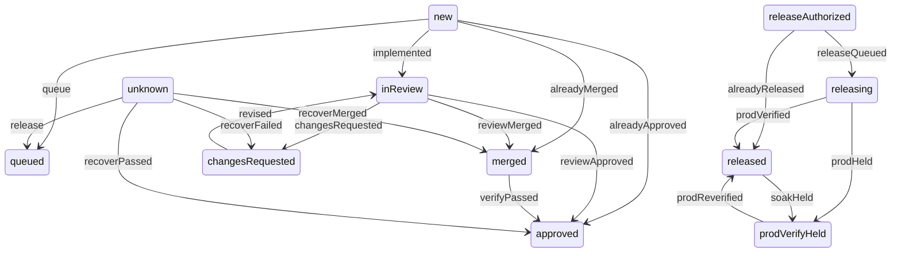

<!-- GENERATED by scripts/docs/generate-lifecycle.mjs from src/lifecycle.ts and src/adapters.ts. Do not edit by hand: run `npm run build && npm run docs:generate`. -->

# The Foreman lifecycle

[Project README](../README.md) · [All documentation](README.md)

## Contents

- [Stages](#stages)
- [Moves](#moves)
- [Sessions](#sessions)
- [Releases](#releases)
  - [The release stage](#the-release-stage)
- [Unblocking a card](#unblocking-a-card)
- [Events](#events)

Every work item moves through one state machine, `src/lifecycle.ts`. The orchestrator never names
a state change itself: it calls `advance(item, "<move>")` (`src/work-source.ts`), which looks the
move up in the table below and emits one `transition` event. Everything else it reports is an
event too, through the same `emit()`.

Each event goes to two kinds of listener, and neither reads the other:

- **The work source** (`WorkSourceAdapter.record`) — today GitHub issues (`src/github-work-source.ts`),
  which turns each move into exactly one `gh issue edit` of lifecycle labels. Other events write nothing there.
- **Observers** (`WorkObserver.onEvent`) — optional plugins, queued and best-effort: the Paperclip
  board mirror (`src/paperclip/`, on when `paperclip.enabled`) and the daemon's activity log. An
  observer that fails or hangs never stops the Foreman.

So the core calls one interface; GitHub is updated, and Paperclip too when it is enabled.

## Stages

Where an item can be. The `…ing` stages exist only while a session runs.

On a GitHub issue each stage is one label. Where an issue carries more than one, the stage is
the first that applies in `issueStage` (`src/github-work-source.ts`): `blocked`, `done`,
`prodVerifyHeld`, `releasing`, `releaseAuthorized`, `awaitingRelease`, `pendingVerification`, and so on
back to `approved`. The Foreman writes every label except the EM's `ready for prod release`;
`pendingVerification` is the one stage waiting on the EM.

| Stage | Label | Meaning |
|---|---|---|
| `approved` | `approved` | Authorized and waiting to be built (or queued behind an open feature PR). |
| `implementing` | — (a session holds it) | An implement session is building it. |
| `inReview` | `pr under review` | Its PR is open and waiting for review. |
| `reviewing` | — (a session holds it) | A review session is reviewing its PR. |
| `changesRequested` | `pr pending actions` | The review asked for changes, or CI bounced the PR; waiting to be revised. |
| `revising` | — (a session holds it) | A revise session is addressing the review. |
| `merged` | `pr merged` | Merged to the base branch; waiting for dev verification. |
| `verifying` | — (a session holds it) | A verify session is checking it in dev. |
| `pendingVerification` | `pr approved` | Dev-verified (or merged with no verify stage); awaiting EM verification, which ends in the release authorization. |
| `releaseAuthorized` | `ready for prod release` | The EM verified it and authorized production; the promote stage puts it in a release PR next. |
| `awaitingRelease` | an open release PR names it | In an open release PR the release stage does not own (no release label: opened by hand, or before the release stage ran). |
| `releasing` | `release pending` | In a release PR the Foreman owns: the Tech Lead approves it, then the SRE merges, deploys and verifies it in production. |
| `prodVerifyHeld` | `prod verification held` | Deployed to production, but the SRE's prod verification held or failed; the Foreman re-verifies it on a back-off. |
| `needsRuling` | — (a session holds it) | Its PR is not converging under review (sent back REVIEW_ROUNDS_ALERT times since the last ruling, or the Tech Lead flagged a spec question); revision waits for the EM's scope ruling. Or a skipped issue used up backoff.skip.maxAttempts sessions; it runs again once a person changes the issue (an agent's edit or label buys one session; its comment releases nothing). |
| `blocked` | `blocked` | Needs a person: blocked on the source, or the Foreman declined it or ran out of retries. |
| `done` | closed or `ready to close` | Closed by the Foreman after the SRE's prod verification passed. |

## Moves

Every state change the Foreman makes. *From* is the state the caller knows the item is in;
`unknown` means the work source reads the item first and changes only what is there (recovery).

| Move | From | To | Stage | When |
|---|---|---|---|---|
| `queue` | new | queued | `approved` | Held behind an open feature PR on the same branch; builds once that PR merges or closes. |
| `implemented` | new | inReview | `inReview` | An implement session (or a reconciliation, or orphan adoption) opened the PR. |
| `alreadyApproved` | new | approved | `pendingVerification` | Implement found the work already merged and there is no verify stage. |
| `alreadyMerged` | new | merged | `merged` | Implement found the work already merged; dev verification is next. |
| `reviewApproved` | inReview | approved | `pendingVerification` | The review approved and merged, and there is no verify stage. |
| `reviewMerged` | inReview | merged | `merged` | The review approved and merged; dev verification is next. |
| `changesRequested` | inReview | changesRequested | `changesRequested` | The review asked for changes, its CI is red, or a stranded changes-requested verdict is caught up. |
| `revised` | changesRequested | inReview | `inReview` | A revise session pushed changes; back to review. |
| `verifyPassed` | merged | approved | `pendingVerification` | Dev verification passed; the EM verifies next, and authorizes production with `ready for prod release`. |
| `recoverPassed` | unknown | approved | `pendingVerification` | Dead-zone recovery: a merged PR left its issue unadvanced, and a fresh verification passed. |
| `recoverFailed` | unknown | changesRequested | `changesRequested` | Dead-zone recovery: a fresh verification failed. |
| `recoverMerged` | unknown | merged | `merged` | Dead-zone recovery with a verify stage: the merge is recorded and verification follows. |
| `release` | unknown | queued | `approved` | An orphan: in review with no open PR; released back to the queue. |
| `releaseQueued` | releaseAuthorized | releasing | `releasing` | The promote stage put an EM-authorized item in the release PR (opened, updated, or already listing it), or found its work already in production with no prod verification on record. |
| `alreadyReleased` | releaseAuthorized | released | `done` | Authorized, its work already in production, and a passed prod verification on record for it: closed. |
| `prodVerified` | releasing | released | `done` | The release PR merged (tagged) and the SRE's prod verification passed: commented and closed. |
| `prodHeld` | releasing | prodVerifyHeld | `prodVerifyHeld` | The release PR merged (tagged) but prod verification held, failed or did not run: labelled, reopened if GitHub's keywords closed it, re-verified on a back-off. |
| `prodReverified` | prodVerifyHeld | released | `done` | A later prod re-verification passed: commented and closed. |
| `soakHeld` | released | prodVerifyHeld | `prodVerifyHeld` | Closed after prod verification, but the SRE's 30-minute soak held or failed: reopened, labelled, re-verified on a back-off. |

## Sessions

While a session runs it holds its items in a stage; when it ends with nothing newer said, they return to the fallback.

| Session | Holds items in | Falls back to |
|---|---|---|
| implement | `implementing` | `approved` |
| review | `reviewing` | `inReview` |
| verify | `verifying` | `merged` |
| revise | `revising` | `changesRequested` |

## Releases

| Release PR | Leaves its items in |
|---|---|
| open | `awaitingRelease` |
| merged | `done` |
| closed | where they were |

With the release stage on, a merge is not the end: the moves after it (`prodVerified`, `prodHeld`) place each item again in the same pass.

### The release stage

`release` is a built-in stage after `promote`, with no Claude session. It is on by default only when both
`srePath` and `techLeadPath` are set; otherwise it is skipped with a startup warning, and an explicit
`release` in `stages` without both is refused at startup. From merge to close the Foreman writes every
lifecycle label; the one label a person writes is the EM's `ready for prod release`.

1. **Promote** moves each `ready for prod release` issue into the release PR and to `release pending`
   (also when it updates an existing PR). When the base branch has nothing to promote (a 0-file diff),
   the issue's work is already in production: it is closed only on evidence (a passed prod verification
   the release stage recorded for it, in `.agent-state.json`, at the commit production is at now);
   otherwise it gets `release pending` and the release stage verifies it.
2. **Tech Lead** approves the release PR at its exact head (`tech-lead.mjs approve-promotion`). A refusal
   blocks the PR's issues with a comment; anything other than approve or refuse backs off (`backoff.releaseRetry`).
3. **SRE** merges, deploys and verifies (`sre.mjs deploy`, up to `sreDeployMaxDurationMs`). Its
   `SRE_DEPLOY` trailer decides the outcome: only `hold=predeploy-stop` blocks; every other hold, and
   any run without a trailer, is retried.
4. **Tag.** Once merged, the merge commit gets an annotated tag named by `github.releaseTagFormat`
   (reused if one is already there). Never a GitHub Release object, never a `v` prefix.
5. **Close or hold.** A pass comments on each issue (tag, merge commit, evidence), strips its lifecycle
   labels and closes it. A hold or fail labels it `prod verification held`, reopens it if GitHub's
   keywords closed it, comments the reason, and re-verifies (`sre.mjs verify --mode prod`) on
   `backoff.prodVerifyRetry`. No issue is ever left closed-but-unverified or open-but-unlabelled.
6. **Soak.** At least 30 minutes after the merge, the stage runs `sre.mjs verify --mode soak` once;
   a hold or fail reopens the issues to `prod verification held`.

**Adoption.** A base → production PR merged in the last 48 hours by anyone else, whose lifecycle issues
this stage has not closed, is adopted: no Tech Lead or deploy, but a prod verification (or the result of
an existing `## Production Verification` comment), the tag, the soak, and the same close/hold paths.
Issues the SRE's promotion-verify sweep marked `blocked` ("**Production release check needs a person.**")
are moved to `prod verification held`. The SRE's promotion-verify-sweep (a systemd timer on the owner's
desktop) is retired once this ships.

The promote and release path sends nothing to Discord: what needs a person is a comment and a label
on the issue, which also moves its Paperclip card.

## Unblocking a card

**Unblock on GitHub, never on the board.** The Foreman reads GitHub, not Paperclip: a Blocked card
only mirrors a hold the Foreman keeps on the issue. Moving the card to To Do, or handing it to the
Foreman's agent, releases nothing. That agent never wakes from Paperclip, and the next move or sync puts
the card back. Do the act that releases the hold, below. The Foreman checks every held item each pass
(`src/unblock.ts`), and when a check passes it clears its own state, moves the card back to the
column its GitHub labels call for, and notes which check released it.

**Which block is it?** The card's unblock note and the Foreman's last comment on the issue or PR
give the reason. A skip's comment names what it waits on.

| Block | Why the Foreman stopped | Released by (any one, checked in this order) |
|---|---|---|
| `skip` | The implement session declined the issue: a precondition outside the repo, investigation only, or already done. Its comment on the issue says what it waits on. | Clear the condition the skip named (reconcile the branch, close the blocking PR). Close or merge the issue or PR the skip named in `waiting_on`. Edit, comment on or label the issue (anyone but the Foreman). Escalated: see below. |
| `divergence` | The feature branch diverged from its base. | Reconcile the feature branch with its base. |
| `verify-no-pr` | The issue is labelled merged, but no merged PR closes it. | Merge a PR into the base branch that closes the issue. |
| `verify-held` | Dev verification failed and is waiting out its back-off; it retries by itself. | Edit the issue's body (the spec the SRE verifies against). |
| `verify-exhausted` | Dev verification failed its last attempt. | Edit the issue's body (the spec the SRE verifies against). Land a fix on the base branch. |
| `revision-exhausted` | Revision of the issue's PR failed its retries. | Push a commit to the PR. |
| `revision-stalemate` | The reviser and the reviewer disagree, and the reviser pushed nothing. | Push a commit to the PR. |
| the `blocked` label | A person or tool labelled the issue `blocked`: the Foreman never picks it up. | Remove the label. |
| `needsRuling`: PR not converging | The PR was sent back REVIEW_ROUNDS_ALERT times since the last ruling, or the Tech Lead flagged a spec question. | Post a comment on the PR whose first line opens `**EM scope ruling`. |
| `needsRuling`: skip escalated | A skip used up `backoff.skip.maxAttempts` sessions in a row. | See below. |

**An escalated skip** stops reading the condition and the waited-on reference: only a change to the
issue counts, and who made it matters. A person's edit, comment or label releases it and resets the
attempt count. An account in `backoff.skip.agentLogins` (another agent: the EM, the SRE, a reviewer) is
not a person: its edit or label buys one session and keeps the count, so a second skip escalates again;
its comment releases nothing. So an agent that has cleared the precondition records that in the
issue body (an edit), not in a comment. Don't touch an issue whose precondition is still unmet: every
release spends a session.

The card notes for each release are in `CHECK_WORDS`. A wait the Foreman clears by itself (an occupied
branch, a dev verification waiting on a deploy, a prod verification held on a back-off) needs nothing.

## Events

The full `WorkEvent` contract (`src/adapters.ts`). Only `transition` writes to the work source.

| Event | Meaning |
|---|---|
| `claim` | The Foreman took the item for an implement session. |
| `transition` | A lifecycle move (the table below). `observed: true` when an AI session already wrote the labels itself and the Foreman is only reporting what it saw: the work source does not write again. |
| `prLink` | The item's PR was opened. |
| `blocked` | The Foreman stopped and needs a person (the reason says why). |
| `verifyWaiting` | Dev verification waits on something that clears by itself and resumes on its own; no person is needed. |
| `escalated` | Work stopped for the EM's ruling: the PR is not converging under review (a scope ruling on the PR resumes it), or a skipped issue used up `backoff.skip.maxAttempts` sessions (a person changing the issue resumes it; an agent's edit or label buys one session, its comment nothing). See [Unblocking a card](#unblocking-a-card). |
| `unblocked` | A check resolved an earlier block. |
| `merged` | The item's PR merged to the base branch. |
| `promoted` | A promotion PR to the production branch now carries the item. |
| `session` | A session (implement, review, verify, revise) started or ended, with the items it held. |
| `reviewProgress` | A running Tech Lead review reached a new stage (reading, depth check, final check): every milestone so far, at most once per stage. |
| `waiting` | Items the Foreman is holding, and on what (an occupied branch, a back-off). |
| `release` | A release PR opened, merged or closed, with the items it carries. |
| `promotionStall` | Promotion is stuck (the base branch is ahead of production and nothing is marked ready), or cleared. |
| `backoff` | A daemon-wide pause on an upstream (GitHub rate limit, Claude session limit) began or ended. |
| `snapshot` | After each pass: every open item's stage as the work source sees it, so a plugin can heal drift. |
